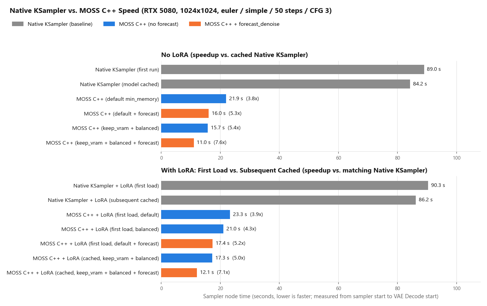

# Comfy_moss_cpp

**English** | [繁體中文](README.zh-TW.md)

Standalone ComfyUI sampler node integrating [mossimage.cpp / MossInfer](https://github.com/mossimage-cpp/mossimage.cpp) into native ComfyUI workflows. Built with the ComfyUI V3 API, it plugs directly into standard `MODEL`, `CONDITIONING`, and `LATENT` connections without replacing your text encoder, VAE, LoRA loaders, or workflow layout.

**Minimum requirement:** ComfyUI v0.22.0+ (requires the 4-argument `comfy.sample.fix_empty_latent_channels`; verified on v0.45.4).

## Speed



Measured on a local **RTX 5080 16 GB** under identical settings: **1024×1024, `euler`, `simple`, 50 steps, CFG 3, batch 1**, using the exact same INT8 ConvRot model. The LoRA group uses native `Load LoRA` (`moss_黑白線稿.safetensors`, `strength_model = 0.7`). Timing covers the sampler node execution (from sampler start to VAE Decode start); `keep_vram` subsequent runs are measured from the 2nd image onward.

- **Gray (Native ComfyUI KSampler):** No LoRA: 89.0 s first run / 84.2 s cached; with LoRA: 90.3 s first load / 86.2 s subsequent cached.
- **Blue (MOSS C++, no forecasting):** No LoRA: 21.9 s default (`3.8×`), 15.7 s with `keep_vram` + `balanced` (`5.4×`); with LoRA: 21.0–23.3 s first load (`3.9–4.3×`), 17.3 s subsequent cached (`5.0×`). Enabling `keep_engine` eliminates per-image DiT reloads with bit-identical pixel output (see [LOSSLESS_ACCELERATION_RESEARCH.md](LOSSLESS_ACCELERATION_RESEARCH.md)).
- **Orange (MOSS C++ + `forecast_denoise`):** No LoRA: 16.0 s default (`5.3×`), 11.0 s persistent (`7.6×`); with LoRA: 17.4 s first load (`5.2×`), 12.1 s subsequent cached (`7.1×`). Denoise forecasting may slightly alter text or fine details.
- For further step reduction (e.g., `dpmpp_2m` + `beta` at 20 steps), see [MATH_ACCELERATION_RESEARCH.md](MATH_ACCELERATION_RESEARCH.md).

Regenerate the chart: `python docs/speed_chart.py`.

## Installation

### Hardware & Environment Requirements

- **ComfyUI:** v0.22.0+ (verified on v0.45.4). No extra Python packages required (uses ComfyUI's bundled `torch`, `numpy`, and `Pillow`).
- **GPU:** **NVIDIA CUDA GPUs only** (non-CUDA / AMD / Intel environments automatically fall back to the native ComfyUI KSampler).

| GPU Generation | Architecture | Engine Package | Minimum Driver |
| --- | --- | --- | --- |
| RTX 50 / 40 / 30 series (incl. A100 / L40) | Ampere / Ada / Blackwell | Standard package (CU13 or CU12) | CU13: ≥ 580<br>CU12: Win ≥ 527 / Linux ≥ 525 |
| RTX 20 / GTX 16 series | Turing (`sm_75`) | Upstream **`-sm75`** package | ≥ 580 |
| Tesla V100 | Volta (`sm_70`) | Linux CUDA 12 **`-sm70`** package | ≥ 525 |

> `turbo` NVFP4 weights require an RTX 50 series GPU. On RTX 30 / 40 series, use `high` (INT8) or `reference` (BF16).

### Option 1: Windows All-in-One Package (Recommended for RTX 30 / 40 / 50, Driver ≥ 580)

1. Download **`Comfy_moss_cpp-v1.0.0-windows-cu13-allinone.zip`** from [GitHub Releases](https://github.com/ShiQu1218/Comfy_moss_cpp/releases) (bundles the official `mossinfer-2.2.1-windows-cu13-x86_64` runtime and `moss-lokr-cache.exe`).
2. Extract it into `ComfyUI/custom_nodes/` so the path is `ComfyUI/custom_nodes/Comfy_moss_cpp/__init__.py` (avoid nested duplicate folders).
3. Follow **Model Configs & Weights** below, then restart ComfyUI.

### Option 2: Manual Installation (Linux, CUDA 12 Drivers, or RTX 20 `-sm75`)

1. Clone this repository into `ComfyUI/custom_nodes/` (or extract `Comfy_moss_cpp-v1.0.0.zip` from Releases):
   ```powershell
   git clone https://github.com/ShiQu1218/Comfy_moss_cpp.git
   ```
2. Download the matching binary package for your OS, GPU, and CUDA driver from the upstream [MossInfer v2.2.1 Release](https://github.com/mossimage-cpp/mossimage.cpp/releases/tag/v2.2.1) (e.g., `windows-cu12`, `windows-cu13-sm75`, `linux-cu13`). Verify `SHA256SUMS` and extract the **entire package** into `Comfy_moss_cpp/runtime/`.
   - Expected path: `Comfy_moss_cpp/runtime/<package-name>/bin/moss-infer.exe` (`moss-infer` on Linux).
   - Keep only one runtime package in `runtime/`, and keep all accompanying DLLs / shared libraries. Alternatively, set `MOSSIMAGE_CPP_EXECUTABLE` before starting ComfyUI.
3. Follow **Model Configs & Weights** below, then restart ComfyUI.

### Model Configs & Weights

1. Download the official MOSS-Image SFT (or Base) config and tokenizer files (small metadata files only; replace the target path with your ComfyUI directory):

```powershell
hf download OpenMOSS-Team/MOSS-Image-SFT --revision 2c7954437269461767f533b006823e8f85973a60 --include '*/config.json' --include 'tokenizer/*' --include 'model_index.json' --include 'scheduler/*' --local-dir 'D:/ComfyUI/ComfyUI_windows_portable/ComfyUI/models/mossimage/MOSS-Image-SFT'
```

2. Place compatible model weights in ComfyUI's standard model folders:

| Component | Directory | Example Filename |
| --- | --- | --- |
| DiT | `models/diffusion_models/` | `moss_image_sft_int8_convrot.safetensors` |
| Text Encoder | `models/text_encoders/` | `qwen3.5_9b_int8_convrot.safetensors` |
| VAE | `models/vae/` | `flux2-vae_small.safetensors` |

3. Restart ComfyUI. In any MOSS-Image workflow, replace the native `KSampler` with **KSampler (MOSS Image C++)** — or import [workflows/modular.json](workflows/modular.json).

## Integrating into Existing Workflows

Add **KSampler (MOSS Image C++)** in place of the standard `KSampler` and wire the same four inputs and latent output:

| Node Input / Output | Connect To |
| --- | --- |
| `model` | `Load Diffusion Model` (MOSS-Image `MODEL`) |
| `positive` / `negative` | `CLIP Text Encode` positive / negative `CONDITIONING` |
| `latent_image` | `EmptyLatentImage`, `EmptySD3LatentImage`, `EmptyFlux2LatentImage`, or native `VAE Encode` `LATENT` |
| `LATENT` output | Native `VAE Decode` → `SaveImage` |

- Keep `weight_dtype` set to `default` on `Load Diffusion Model`. Text encoding and VAE decoding remain handled by native ComfyUI; only the DiT denoising loop runs in C++ via shared memory.
- Currently limited to batch size 1; image dimensions must be multiples of 16.
- **Advanced option `forecast_denoise`** (default `False`): experimental velocity extrapolation across nearby sigma steps to skip selected DiT evaluations. May alter text or fine details.
- **Advanced options `memory_mode` & `cuda_graphs`**: when VRAM allows, set `memory_mode` to `balanced` to keep DiT weights resident on GPU, and optionally enable `cuda_graphs` for repeated shapes. See [HARDWARE_BITWISE_RESEARCH.md](HARDWARE_BITWISE_RESEARCH.md).
- **Advanced option `keep_engine`** (`off` / `release_vram` / `keep_vram`, default `off`): keeps the C++ `moss-server` process alive between images to avoid reloading the DiT each run, producing bit-identical pixels.
  - `release_vram`: frees VRAM between runs (keeps a host RAM copy if memory allows; reload takes ~0.4 s).
  - `keep_vram`: keeps DiT resident in VRAM (`min_memory` ~1.6 GB, `balanced` ~7.1 GB) for maximum speed. Note that ComfyUI does not manage this VRAM, so loading other large models in the same ComfyUI instance may OOM.
  - Automatically restarts the server if the DiT file, tier, memory mode, or CUDA Graph setting changes, or on error/cancellation.

### LoRA / LoHa / LoKr / DoRA

Use native **Load LoRA**, **Load LoRA (Model Only)**, or **rgthree Power LoRA Loader** as usual and connect the resulting `MODEL` to **KSampler (MOSS Image C++)**. Multiple stacked LoRAs, positive/negative strengths, and alphas are supported (`strength_clip` is handled natively by ComfyUI's CLIP path).

| Adapter Format | Handling |
| --- | --- |
| Standard LoRA (kohya, PEFT, diffusers) | Passed directly as low-rank tensors, alpha, and strength to C++ |
| Linear LoHa / LoKr | Passed with original factors and native alpha rules to C++ |
| DoRA, LoCon, Tucker, other native WeightAdapters | Computed natively via ComfyUI's patch stack and forwarded as weight deltas |
| Full diff / bias diff | Applied directly in C++ |

#### LoKr & DoRA Disk Cache (`cache_lokr`)

Enabled by default. Merging and INT8-requantizing large LoKr adapters can take tens of seconds per run. With `cache_lokr` enabled, the first run merges the adapter into a cached DiT file under `cache/lokr/` (GPU-accelerated via `runtime/moss-lokr-cache.exe`, reducing full-model merge from ~51 s on CPU to ~10.7–18 s with bit-identical weights; falls back to CPU automatically if CUDA is unavailable). Subsequent runs with the same model, adapter set, and strengths load directly from disk, even across ComfyUI restarts. Only the most recent combination is cached (~1× DiT disk size). See [GPU_LOKR_REPORT.md](GPU_LOKR_REPORT.md) and [DORA_CACHE_REPORT.md](DORA_CACHE_REPORT.md).

### Skip Layer Guidance (SLG)

Directly supports native **SkipLayerGuidanceDiTSimple** and **SkipLayerGuidanceDiT** (including stacked SLG + LoRA). MOSS-Image only has `single_block` layers (valid indices `0–41`); up to 8 total prediction rows per session are supported by the engine. See [workflows/slg.json](workflows/slg.json) and [EXTENDED_TEST_REPORT.md](EXTENDED_TEST_REPORT.md).

### Reference Images (`ReferenceLatent`)

Supports native **ReferenceLatent** in C++ (reference KV states are computed once at `run_begin` and reused across all steps):
- Positive and negative conditioning must carry identical reference latents with `reference_latents_method = index_timestep_zero_text_start` (up to 4 images, ≤ 16,384 total latent tokens; cannot be combined with SLG).
- Requires a `moss-server` built with [patches/mossinfer-2.2.1-reference-latents.patch](patches/mossinfer-2.2.1-reference-latents.patch). If the installed `moss-server` does not advertise `run_reference_latents` (such as the stock upstream v2.2.1 binary), the node automatically warns and falls back to the native KSampler without failing.
- Measured on RTX 5080 (1024×1024, 20 steps, CFG 4, one 768×1024 reference image): native 62.5 s → C++ **13.3 s** (`4.7×`).

#### Building the Reference-Latent Server (Optional)

```powershell
git clone https://github.com/mossimage-cpp/mossimage.cpp
cd mossimage.cpp
git checkout f4f38f5e90d9990795d125b357574a68aadbe924
git apply <this-repo>/patches/mossinfer-2.2.1-reference-latents.patch
cmake --preset windows-msvc-cuda13 -DCMAKE_CUDA_ARCHITECTURES=120-real   # adjust for your GPU
cmake --build build/windows-msvc-cuda13 --target moss-server mossinfer
```

Replace `moss-server.exe` and `mossinfer.dll` inside `runtime/<package-name>/bin/` (back up the originals first).

## Scope & Limitations

- The legacy all-in-one node (`MossImageCpp`) is preserved for backward compatibility with older workflows.
- `high` pairs with INT8 DiT; `reference` requires BF16 DiT; `turbo` requires upstream-supported INT4 / NVFP4 DiT. Weights are not auto-converted between precisions.
- ControlNet, regional/scheduled conditioning, noise masks, batch size > 1, and arbitrary third-party `MODEL` callbacks are not supported in C++ and will raise an explicit error (or fall back where noted).
- Upstream baseline: MossInfer **2.2.1** (commit `f4f38f5e90d9990795d125b357574a68aadbe924`).

## References & License

| Project | Role |
| --- | --- |
| [mossimage.cpp / MossInfer](https://github.com/mossimage-cpp/mossimage.cpp) (Apache-2.0) | C++/CUDA inference engine & component session protocol; `patches/` modifies v2.2.1 (`f4f38f5`), and the LoKr helper compiles its merge/quantization routines |
| [ComfyUI](https://github.com/comfyanonymous/ComfyUI) | Node V3 API, native sampling loops, LoRA/WeightAdapter, SLG, and ReferenceLatent semantics |
| [OpenMOSS MOSS-Image](https://huggingface.co/OpenMOSS-Team/MOSS-Image-SFT) | Model architecture, configs, and tokenizer |
| [rgthree-comfy](https://github.com/rgthree/rgthree-comfy) | Power LoRA Loader compatibility and profiling |
| [Dao-AILab fast-hadamard-transform](https://github.com/Dao-AILab/fast-hadamard-transform), [FlashAttention](https://arxiv.org/abs/2205.14135), [NVIDIA CUDA Docs](https://docs.nvidia.com/cuda/) | References for mathematical equivalence and hardware reproducibility research |

Files under `patches/` are derivative works of `mossimage.cpp` distributed under **Apache-2.0**. Upstream binary licenses and CUDA notices are preserved in `runtime/`. For all other files in this repository, do not assume a license until one is explicitly added.
